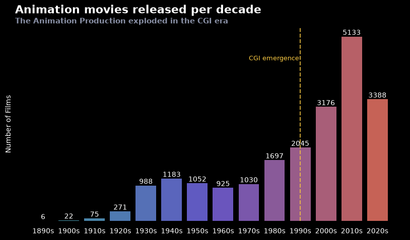
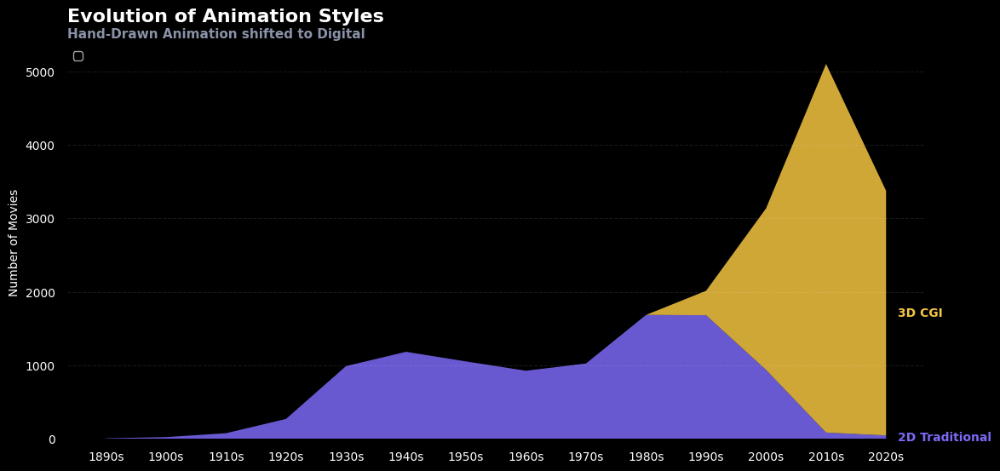
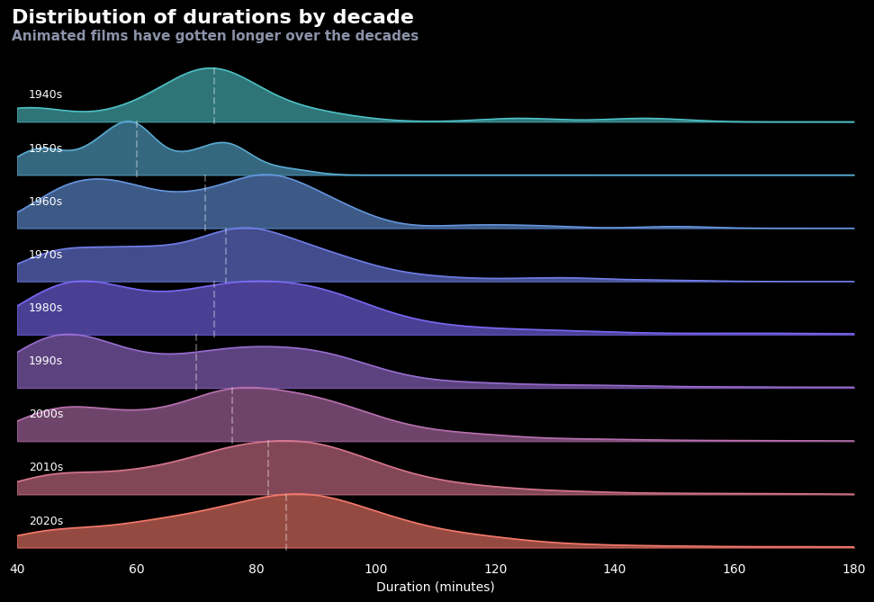
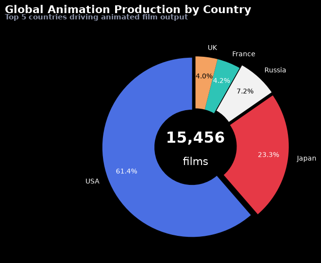
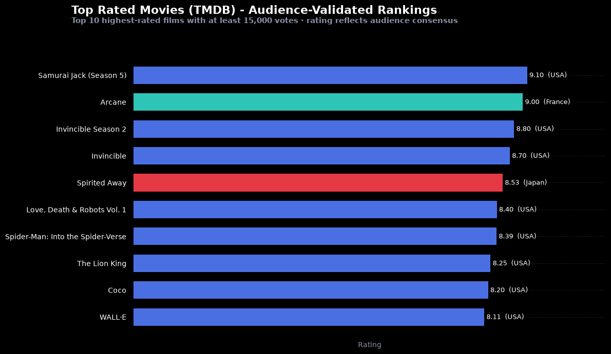
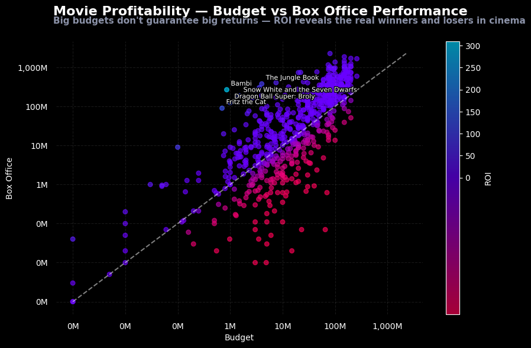
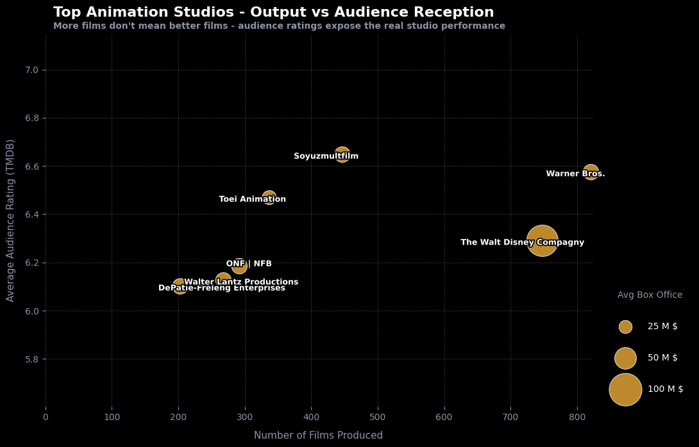

# Animation Movies — A Data-Driven Journey Through Cinema History

Data visualization dashboard built in Python (pandas, matplotlib, seaborn).

The dataset covers ~25,000 animated films released between 1878 and 2029, sourced from TMDB (The Movie Database). After cleaning, the analysis keeps **15,456 films** across 130+ years of history.

## Questions

1. How has the volume of animation production evolved over time, and which decade marked the biggest turning point?
2. When did 3D CGI overtake 2D Traditional animation, and how dramatic was the transition?
3. Does a higher budget guarantee better box office performance?
4. Which countries and studios dominate global animation output, both in volume and in audience ratings?

## Dashboard

| # | Chart | Type | Key insight |
|---|---|---|---|
| 1 | Animation movies released per decade | Bar chart | Production exploded with the CGI era (5,000+ films in the 2010s) |
| 2 | Evolution of animation styles | Stacked area | 3D CGI replaced hand-drawn 2D within about one decade |
| 3 | Distribution of durations by decade | Ridge plot | Animated films have gotten longer over the decades |
| 4 | Global animation production by country | Donut chart | USA (61%) and Japan (23%) account for over 84% of all films |
| 5 | Top rated movies (TMDB) | Horizontal bar | Audience favorites with at least 15,000 votes |
| 6 | Budget vs box office | Log-log scatter | A big budget helps but does not guarantee success |
| 7 | Top animation studios | Bubble chart | More films don't mean better films |









## Dataset

The dataset is **not included** in this repository.

- Source: [Animation Movies Complete Dataset (1878–2029)](https://www.kaggle.com/datasets/rudrakumargupta/animation-movies-complete-dataset-18782029) on Kaggle, by Rudra Kumar Gupta
- File: `animation_movies_enriched_1878_2029.csv` (~20 MB, 25,390 rows, 44 columns)

Download it and place it at the root of the project, next to `dashboard_final.ipynb`.

### Variables used

| Variable | Description | Unit / Type |
|---|---|---|
| `Movie_Name` | Title of the animated film | Text |
| `Decade` | Decade of release | Category (e.g. 1990s) |
| `Animation_Style` | Animation technique | 2D Traditional / 3D CGI |
| `Movie_Length_Minutes` | Runtime | Minutes |
| `Country_Origin` | Country of production | Text (e.g. USA, Japan) |
| `Studio` | Main production studio | Text |
| `TMDB_Rating` | Audience score on TMDB | Score 0–10 |
| `TMDB_Vote_Count` | Number of votes on TMDB | Count |
| `Budget_Million_USD` | Production budget | Millions USD |
| `Box_Office_Million_USD` | Total box office revenue | Millions USD |

### Cleaning

- Dropped unused columns (IDs, URLs, overviews, languages, quality flags…)
- Removed films with unverified runtimes and unknown decades
- Removed Stop-Motion and Motion Capture films to focus on 2D Traditional vs 3D CGI
- Harmonized country names (`United States` → `USA`, `Soviet Union` → `Russia`, …) and studio names (Disney and Warner Bros. subsidiaries merged)

## Getting started

```bash
git clone https://github.com/jadezrx/animation-movies-data-viz.git
cd animation-movies-data-viz
pip install -r requirements.txt
```

Add the dataset (see above), then open `dashboard_final.ipynb` and run all cells.

## Repository content

| File | Description |
|---|---|
| `dashboard_final.ipynb` | Dashboard notebook |
| `images/` | Exported charts |
| `requirements.txt` | Python dependencies |
